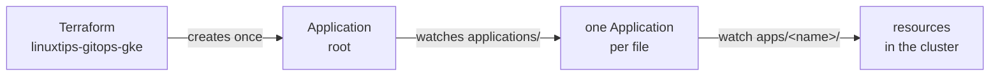

# linuxtips-gitops-argocd

The Git repository **Argo CD watches**, for the **[linuxtips-gitops](https://github.com/LuisGustavoBR/linuxtips-gitops)** learning path. Whatever is committed here is deployed to the GKE cluster created by [linuxtips-gitops-gke](https://github.com/LuisGustavoBR/linuxtips-gitops-gke).

## How It Works



1. Terraform creates a single Application, **`root`**, which watches the `applications/` folder of this repository.
2. Every file in `applications/` is an Argo CD **Application**, and `root` creates it.
3. Each Application deploys the manifests of one folder under `apps/`.

So deploying a new app is a commit: its manifests go in `apps/<name>/`, and its Application goes in `applications/<name>.yaml`.

## Repository Structure

```txt
applications/          # Argo CD Applications (created by the root Application)
  podinfo.yaml
apps/                  # Kubernetes manifests, one folder per app
  podinfo/
    deployment.yaml
    service.yaml
```

## Applications

| Application | Deploys | Namespace | Sync |
|---|---|---|---|
| `podinfo` | `apps/podinfo` (a demo web app) | `podinfo` | automated, with prune and self-heal |

## Rules of This Repository

- **Git is the only way to change the cluster.** Self-heal reverts manual changes, and `git revert` is how a change is rolled back.
- **Manifests have no namespace.** The Application decides where they go.
- **Images use fixed versions**, never `latest`.
- **No secrets in plain text.** This repository is public.

Step-by-step explanations are in [Module 3](https://github.com/LuisGustavoBR/linuxtips-gitops/tree/main/03%20-%20Installing%20Argo%20CD%20and%20the%20First%20Application) of the docs.

## License

[MIT](./LICENSE)
